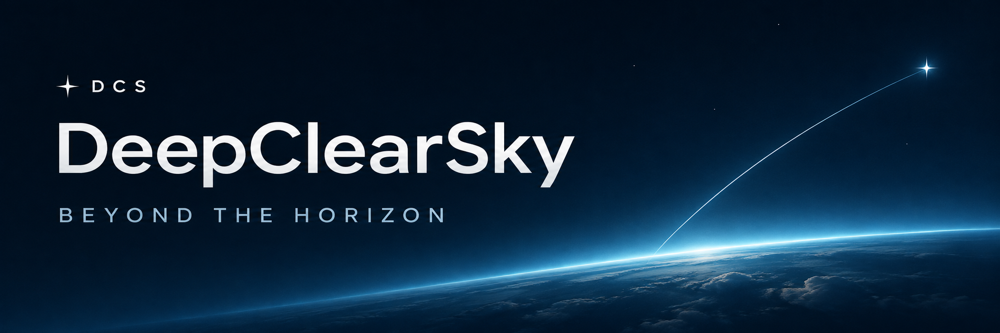
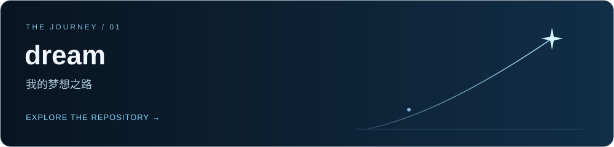

  <strong>心向晴空，步履不停。</strong> 
  保持谦逊，奔赴更远的地方。

  <a href="https://github.com/dcs-humble/dream">梦想之路</a>
  &nbsp; / &nbsp;
  <a href="https://github.com/dcs-humble?tab=repositories">我的仓库</a>
  &nbsp; / &nbsp;
  <a href="https://github.com/dcs-humble">GitHub 主页</a>

## 你好，我是 DCS

你也可以叫我 **DeepClearSky**。

这里记录我的梦想之路：从一个想法出发，一点点探索，一步步实践。
希望留下的记录，也能给路过的你带来一点帮助。

## 我的梦想之路

**[进入 dream →](https://github.com/dcs-humble/dream)**  
我的梦想之路，希望给来访的各位嘉宾提供帮助！

## 接下来，慢慢实现

- [ ] 把梦想拆成可以开始的小目标
- [ ] 记录学习、尝试与收获
- [ ] 把有用的经验整理出来，分享给更多人

 

<!--
**dcs-humble/dcs-humble** is a ✨ _special_ ✨ repository because its `README.md` (this file) appears on your GitHub profile.

Here are some ideas to get you started:

- 🔭 I’m currently working on ...
- 🌱 I’m currently learning ...
- 👯 I’m looking to collaborate on ...
- 🤔 I’m looking for help with ...
- 💬 Ask me about ...
- 📫 How to reach me: ...
- 😄 Pronouns: ...
- ⚡ Fun fact: ...
-->
