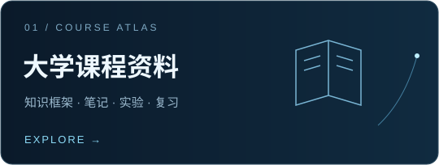
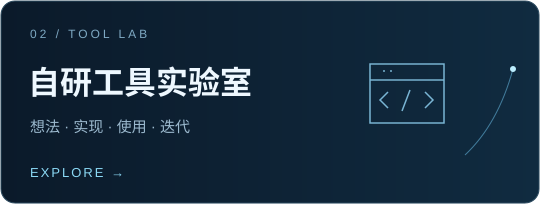

  <strong>大学课程学习资料 · 自研工具</strong> 
  从课堂里的理解，到亲手做出的工具。

  <a href="courses/README.md">课程资料</a> &nbsp; / &nbsp;
  <a href="tools/README.md">工具实验室</a> &nbsp; / &nbsp;
  <a href="docs/START-HERE.md">使用指南</a> &nbsp; / &nbsp;
  <a href="ROADMAP.md">建设计划</a>

## 这里是 DeepClearSky

我是 **DCS**。这里将存放我的大学课程学习资料，以及我研发的一系列工具。

把课堂上的知识整理清楚，把实践中的想法做成工具，再把有用的积累分享出来。这是我想持续做的事。

## 01 / 课程资料

按 **学年 → 学期 → 课程** 逐步建立资料库，让平时学习、实验记录与期末复习都有迹可循。

| 入口 | 内容 |
| :--- | :--- |
| **[课程总目录 →](courses/README.md)** | 按学期查找课程，查看资料整理状态 |
| [课程整理模板](templates/COURSE.md) | 课程说明、知识框架、笔记、实验与复习清单 |
| [资料使用指南](docs/START-HERE.md) | 浏览、下载，以及如何找到需要的文件 |

> **整理状态：** 目录框架已建立，具体课程资料将陆续补充。

## 02 / 工具实验室

存放我研发的工具，记录从需求、实现到迭代的过程。

| 入口 | 内容 |
| :--- | :--- |
| **[自研工具目录 →](tools/README.md)** | 按用途浏览工具，查看使用方式和开发状态 |
| [工具介绍模板](templates/TOOL.md) | 解决什么问题、如何安装、使用示例与常见问题 |
| [版本记录模板](templates/CHANGELOG.md) | 记录新增功能、改进与修复 |

> **收录状态：** 工具目录已建立，具体项目名称与说明待补充。

## 03 / 建设进度

- [x] 建立课程资料与工具的双入口
- [x] 准备课程、工具和版本记录模板
- [ ] 添加第一门课程的资料索引
- [ ] 添加第一个工具的介绍与使用示例
- [ ] 随学习和研发进展持续更新

[查看完整建设计划 →](ROADMAP.md)

<strong>怎样最快找到需要的内容？</strong>

- 找课程资料：进入 **课程总目录**，按学年和学期定位课程。
- 找自研工具：进入 **自研工具目录**，优先阅读工具说明和使用示例。
- 想下载文件：参考 **使用指南** 中的单文件和整库下载方法。
- 想反馈问题：附上课程或工具名称、具体位置与问题描述，便于核对。

 

